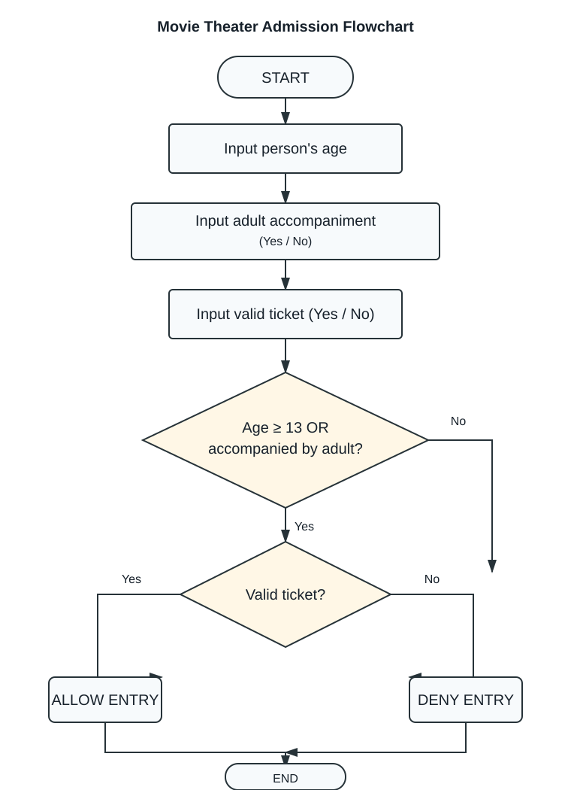

# Tutorial 1 – Movie Theater Admission System

## 1. Identify the Components

### 1.1 Inputs
- `age` (Integer)
- `is_accompanied` (Boolean: True/False)
- `has_ticket` (Boolean: True/False)

### 1.2 Process
1. Check whether `age >= 13` OR `is_accompanied == True`.
2. Check whether the result is True AND `has_ticket == True`.

**Admission expression:** `(age >= 13 OR is_accompanied == True) AND has_ticket == True`

### 1.3 Output
- `is_allowed_entry` (Boolean: True/False)
- True means admission is allowed; False means admission is denied.

## 2. Design the Algorithm

### 2.1 Flowchart



The flowchart checks the age/adult condition and then checks whether the person has a valid ticket. Entry is allowed only when both requirements are satisfied.

### 2.2 Truth Table

Let A = age is 13 or older, B = accompanied by an adult, and C = has a valid ticket.

| A | B | C | A OR B | (A OR B) AND C |
|:---:|:---:|:---:|:---:|:---:|
| 0 | 0 | 0 | 0 | **0 (Denied)** |
| 0 | 0 | 1 | 0 | **0 (Denied)** |
| 0 | 1 | 0 | 1 | **0 (Denied)** |
| 0 | 1 | 1 | 1 | **1 (Allowed)** |
| 1 | 0 | 0 | 1 | **0 (Denied)** |
| 1 | 0 | 1 | 1 | **1 (Allowed)** |
| 1 | 1 | 0 | 1 | **0 (Denied)** |
| 1 | 1 | 1 | 1 | **1 (Allowed)** |

### 2.3 Algorithm (Step-by-Step)
1. Start.
2. Input the person's age, whether they are accompanied by an adult, and whether they have a valid ticket.
3. Check whether the person's age is 13 or older OR they are accompanied by an adult.
4. Check whether they have a valid ticket.
5. If both conditions are true, set the admission status to "Allowed to enter".
6. Otherwise, set the admission status to "Denied entry".
7. Display the admission status.
8. End.

### 2.4 Pseudocode

```text
BEGIN
    READ age, is_accompanied, has_ticket

    IF (age >= 13 OR is_accompanied == TRUE)
       AND has_ticket == TRUE THEN
        DISPLAY "Admission Allowed"
    ELSE
        DISPLAY "Admission Denied"
    ENDIF
END
```

## 3. Evaluate Expression

### 3.1 Test with Input Samples

| Test | Age | Accompanied | Valid Ticket | Expected Result |
|---|---:|---|---|---|
| 1 | 18 | False | True | Admission Allowed |
| 2 | 10 | True | True | Admission Allowed |
| 3 | 10 | False | True | Admission Denied |
| 4 | 15 | False | False | Admission Denied |
| 5 | 12 | True | False | Admission Denied |
| 6 | 13 | False | True | Admission Allowed |
| 7 | 20 | True | True | Admission Allowed |
| 8 | 8 | True | True | Admission Allowed |

### Test Explanation
- Test 1: An 18-year-old with a valid ticket is allowed to enter.
- Test 2: A 10-year-old accompanied by an adult and holding a valid ticket is allowed to enter.
- Test 3: A 10-year-old without an accompanying adult is denied entry.
- Test 4: A 15-year-old without a valid ticket is denied entry.
- Test 5: A 12-year-old accompanied by an adult but without a valid ticket is denied entry.
- Test 6: A 13-year-old with a valid ticket is allowed to enter.

## Conclusion

The movie theater admission condition uses the logical operators OR and AND. A person must be at least 13 years old OR accompanied by an adult, and must always have a valid ticket. The truth table and test cases demonstrate how the admission decision is evaluated.
